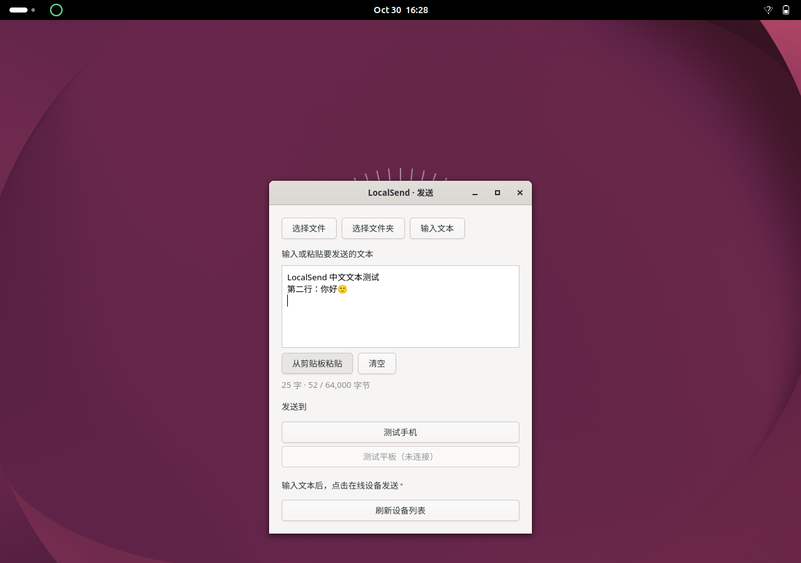

# LocalSend Add · GNOME desktop edition

[](https://github.com/cryuschen/localsend-add/actions/workflows/ci.yml)
[](LICENSE)

**非官方 LocalSend 衍生项目，为 GNOME 桌面提供轻量的文件和文本收发体验。**
基于 [LocalSend](https://github.com/localsend/localsend) 的 Rust 协议实现，与手机、平板及电脑上的官方 LocalSend 客户端通信。本项目由独立维护者开发，与官方团队没有隶属关系。

**Unofficial LocalSend derivative for GNOME.** A shared Rust backend powers a status ring, native GTK4 sender and Nautilus menu. The first desktop release is a **preview**, targeting **Ubuntu 26.04, GNOME Shell 50, Nautilus 50 and GTK ≥ 4.10**. Other desktop environments can use `--cli-only`; desktop integration on other GNOME versions is unsupported. See the [English quick start](support/desktop/QUICKSTART.md).

## 功能

- 顶栏圆环显示后台状态、收发进度、成功、失败及取消；陌生设备需手动确认。
- 原生 Rust / GTK4 窗口选择文件、文件夹或输入文本，支持中文、多行文本与主动粘贴。
- Nautilus 右键发送、设备确认、白名单管理和取消操作。
- 所有入口共用一个后台，避免多个客户端抢占同一端口。
- 普通收发使用 HTTPS，已配对设备验证证书身份；浏览器链接模式明确使用未加密 HTTP。
- CLI 接收使用临时文件，大小与可选校验和验证成功后才发布，已有文件不会被覆盖。



*截图来自隔离 GNOME 测试会话；列表中的手机和平板为测试设备。*

## 下载与安装

从本仓库的 [Releases](https://github.com/cryuschen/localsend-add/releases) 下载桌面版压缩包。官方项目的安装包不包含这里新增的 GNOME 功能。

首版按测试版提供；请先用可丢弃的文件验证与你的手机及桌面环境兼容。以下命令适用于 Ubuntu 26.04：

```bash
sudo apt install python3 python3-gi python3-nautilus gir1.2-nautilus-4.1 gir1.2-gtk-4.0
```

在解压后的目录执行：

```bash
python3 support/desktop/install.py --check
python3 support/desktop/install.py
```

**安装器不使用 sudo**，只安装当前用户的文件，不自动安装系统依赖、不启动后台、不添加登录自启动。已有后台正在运行时会停止安装，请先完成传输，再运行 `localsend stop`。已有的配置、身份和白名单保留；全新安装由后台首次启动时生成自己的身份。

安装完成后退出登录再登录，加载顶栏扩展和文件管理器菜单。如果终端找不到 `localsend`，把 `~/.local/bin` 加入 PATH，或直接运行 `~/.local/bin/localsend-cli start`。完整步骤和回退说明见[安装指南](support/desktop/QUICKSTART.md)。

## 从源码构建

只构建这套桌面功能不需要 Flutter。安装 Rust/rustup（工具链版本由 `rust-toolchain.toml` 指定），以及构建依赖：

```bash
sudo apt install build-essential pkg-config libgtk-4-dev libssl-dev
# 不需要递归下载 Flutter 子模块。
git clone https://github.com/cryuschen/localsend-add.git
cd localsend-add
cargo build --release --locked -p localsend-cli -p localsend-picker --jobs 2
python3 support/desktop/install.py --check
python3 support/desktop/install.py
```

第一次构建需要网络下载 Rust 工具链及 Cargo 依赖。不要给首次构建添加 `--offline`。

## 使用

```bash
localsend start
localsend devices --json
localsend send --to "手机名称" /path/to/file
localsend send --to "手机名称" --text "你好，LocalSend"
localsend status
localsend stop
```

电脑与目标设备必须处于可互相访问的同一局域网，手机端请打开 LocalSend。默认端口为 TCP/UDP `53317`。如果还运行官方桌面应用，请只启动其中一个，或为 CLI 在 `~/.config/localsend-cli/config.toml` 中设置其他端口，例如 `port = 53318`，并允许对应的防火墙流量。安装器不会修改防火墙。

默认接收到系统下载目录。配对设备会自动接受后续传输；只配对你信任的设备。陌生设备请求需在四秒内确认，否则自动拒绝。

## 升级、回退与卸载

先结束传输并停止后台，再用新版的同一安装命令升级。保留发布包或源码中的安装器：

```bash
python3 support/desktop/install.py --rollback
python3 support/desktop/install.py --uninstall
```

回退撤销最近一次安装；卸载移除本安装器管理的文件，并恢复首次安装前的旧文件。两者保留个人配置、身份、配对数据及备份；检测到外部修改或备份损坏会停止操作。桌面组件变更后请重新登录。记录默认存放于 `~/.local/state/localsend-add/`，支持 XDG 目录。

## 已知边界

- 目前没有独立全新虚拟机及真实手机的完整兼容性验收；本机隔离测试通过不代表所有设备组合都已验证。
- 接收文件夹时沿用 CLI 的文件名平铺规则，不重建目录层次；空文件夹不传输。
- 同时收发使用一个顶栏圆环，优先显示最近任务；可通过状态命令检查队列。
- 浏览器分享/上传是可选的 HTTP 模式，不适合敏感内容；关闭后恢复 HTTPS。
- 接收暂存和原子发布要求目标目录所在文件系统支持硬链接（例如 ext4、Btrfs）；不支持时会报告失败并清理暂存文件，不覆盖已有内容。
- 接收会话或上传数据长时间无活动（约两分钟）会被回收。超时不限制持续传输的总时长。
- `support/gnome/install_panel.py`、`support/nautilus/install_local.py` 是历史本机升级脚本，首次安装请使用 `support/desktop/install.py`。

## 开发与反馈

新增桌面代码位于 `cli/`、`picker/`、`support/gnome/`、`support/nautilus/` 和 `support/desktop/`。测试与发布步骤见[维护指南](support/desktop/MAINTAINING.md)，问题请提交到[本仓库 Issues](https://github.com/cryuschen/localsend-add/issues)。安全问题请先阅读 [SECURITY.md](SECURITY.md)，请勿附上设备私钥、个人文件或白名单。

上游 Flutter 应用仍保留在本仓库，其构建与平台资料见[上游说明](support/desktop/UPSTREAM_README.md)及 [CONTRIBUTING.md](CONTRIBUTING.md)；本衍生版的桌面测试不等同于重新发布或认证所有上游平台应用。

## 许可与来源

遵循 [Apache License 2.0](LICENSE)。保留上游 LocalSend 的版权、来源及第三方许可；本项目的修改说明见 [NOTICE](NOTICE) 和 [CHANGELOG.desktop.md](CHANGELOG.desktop.md)。LocalSend 名称用于说明兼容性与来源，本项目不代表官方发行版。
